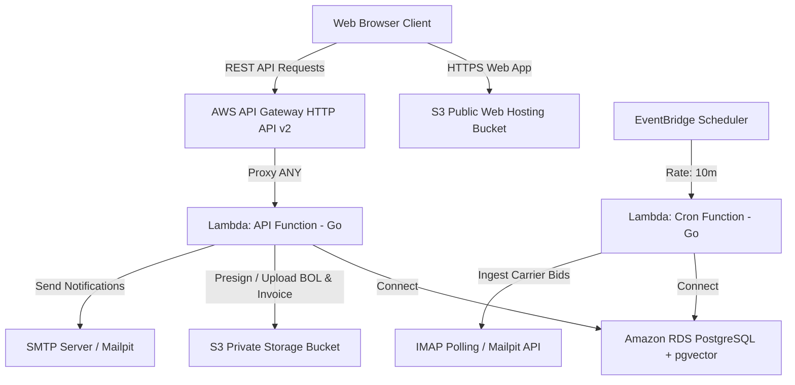
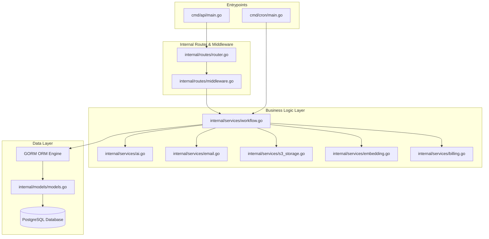
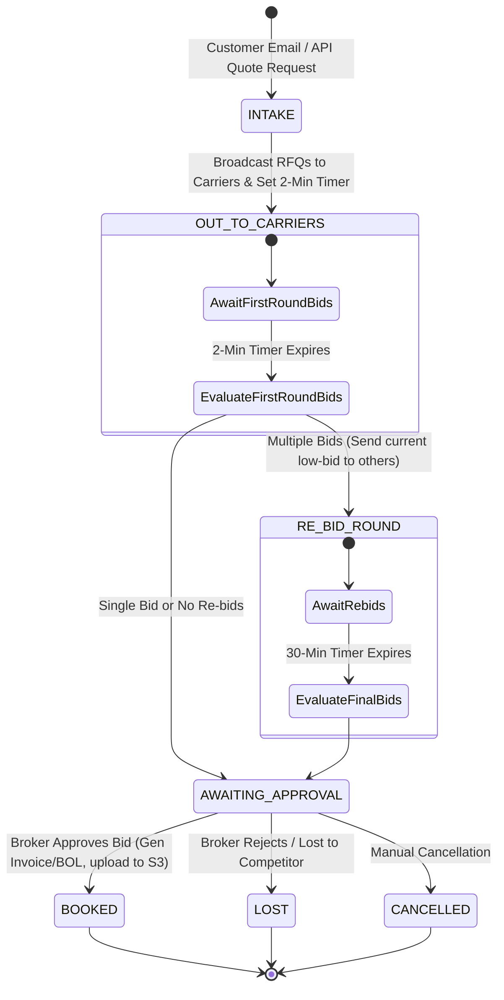

# Freight Agent AWS - Go Migration

A replica of the Python `freight-agent-aws` application, rebuilt in **Golang** for high-performance execution on **AWS Lambda** (custom `provided.al2023` ARM64 runtime). The project connects to a PostgreSQL database (supporting `pgvector` for embedding searches), uses Amazon S3 for private document storage, and hosts a React/Vite web application on S3.

**Live URL**: [https://freight.owera.ca](https://freight.owera.ca)

---

## AWS Architecture



---

## App Architecture



---

## State Machine Workflow



---

## Local Development Setup

Follow these steps to configure and run the application locally on your machine:

### Prerequisites
- **Go**: Version 1.21 or higher.
- **Node.js**: Version 18 or higher (for the frontend React app).
- **PostgreSQL**: A local PostgreSQL database (or access to the RDS database).
- **pgvector Extension**: Required on the PostgreSQL server. Enable it using:
  ```sql
  CREATE EXTENSION IF NOT EXISTS vector;
  ```

### 1. Configuration & Secrets Management
- **Local Development**: Copy `.env.example` to `.env` (gitignored) and `frontend/.env.example` to `frontend/.env` (gitignored).
- **Local Production Builds**: Store production variables in gitignored `.env.production` (backend) and `frontend/.env.production` (frontend).
- **AWS Lambda Production (AWS Secrets Manager)**: Never store secrets in `serverless.yml` or Lambda plaintext environment variables. Sync your gitignored `.env.production` to AWS Secrets Manager (`freight-agent/prod/secrets`):
  ```bash
  ./scripts/push_secrets_to_aws.sh prod us-east-2
  ```
  Both Lambda functions (`api` and `cron`) automatically load runtime secrets from AWS Secrets Manager at cold start via `AWS_SECRET_NAME`.
- **Encryption**: Tenant SMTP/IMAP credentials are encrypted at rest with **AES-256-GCM** (or **AWS KMS Envelope Encryption** when `KMS_KEY_ID` is set) and are never returned in API responses.
- **Monetization (Stripe Option A)** & **Enterprise Organizations**: Configure `STRIPE_SECRET_KEY`, `STRIPE_WEBHOOK_SECRET`, and `STRIPE_PRICE_*` keys in AWS Secrets Manager. Multi-seat Organizations and RBAC team invitations are unlocked on the Enterprise / 3PL tier.

### 2. Start the Backend API Server
Start the Gin HTTP server locally (listens on `:8000` by default):
```bash
go run cmd/api/main.go
```
The server will automatically run table schema migrations and seeds on startup.

### 3. Run Cron Tasks Locally
You can trigger the state machine timer evaluations and email polling manually:
```bash
go run cmd/cron/main.go
```

### 4. Start the Frontend React Web App
1. Navigate to the `frontend` directory:
   ```bash
   cd frontend
   ```
2. Install dependencies:
   ```bash
   npm install
   ```
3. Start the Vite development server (runs on `http://localhost:5173`):
   ```bash
   npm run dev
   ```

### 5. Running Integration Tests
To verify that all local endpoints are working as expected:
```bash
python3 test_api.py
```
*(Ensure `API_URL` in `.env` is set to `http://localhost:8000` before running tests).*

---

## Deployment to AWS

To compile the binaries and deploy the infrastructure using the Serverless Framework:

1. **Build Binaries (cross-compiles to Linux/ARM64 and packages zips):**
   ```bash
   make build
   ```
2. **Deploy Backend (API Gateway, Lambdas, S3 Resources):**
   ```bash
   npx serverless@3 deploy --stage dev --region us-east-2
   ```
3. **Deploy Frontend (Uploads compiled assets to the public S3 Bucket):**
   ```bash
   ./deploy_frontend.sh dev
   ```
